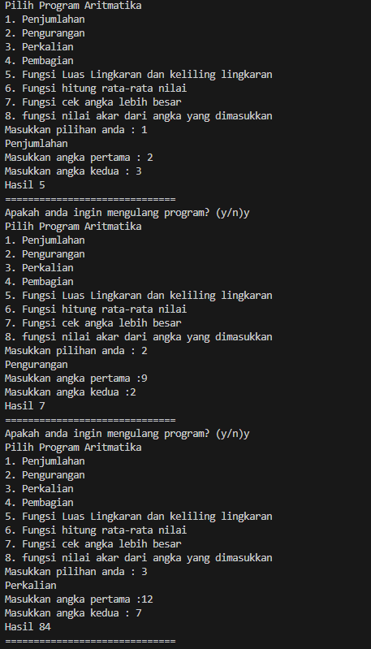
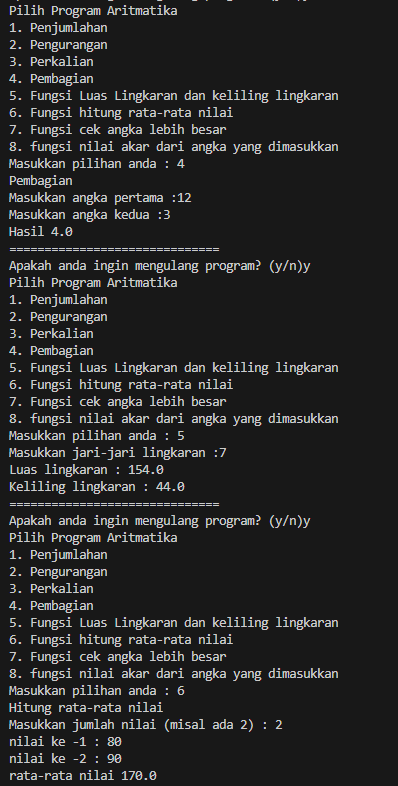
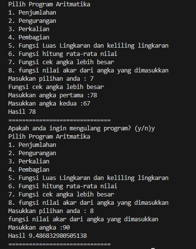
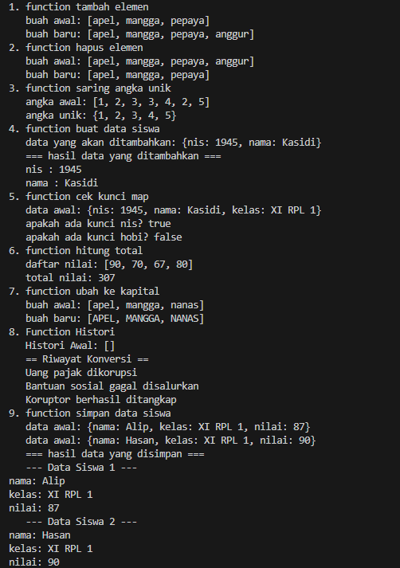

# Project Flutter & Dart

Kumpulan tugas pemrograman Dart dan Flutter.

## Aritmatika

Program Dart berbasis terminal untuk operasi hitung, luas dan keliling lingkaran, rata-rata nilai, membandingkan angka, dan menghitung akar.

Source code: [`Dart/apk 1/lib/latihan.dart`](Dart/apk%201/lib/latihan.dart)

## Data Collection

Latihan pengelolaan data memakai `List`, `Set`, dan `Map`, termasuk menambah dan menghapus elemen, menyaring angka unik, serta mengolah data siswa.

Source code: [`Dart/apk 1/lib/DataCol.dart`](Dart/apk%201/lib/DataCol.dart)

## Splash Screen

Tampilan splash screen dengan logo aplikasi.

## Onboarding

Layar sambutan yang tersedia saat ini. Implementasinya berupa satu halaman `SplashScreen`, belum berupa rangkaian beberapa halaman onboarding.

Source code: [`Flutter/flutter_bu-Rosy/fluter_proj/lib/onboarding_screen.dart`](Flutter/flutter_bu-Rosy/fluter_proj/lib/onboarding_screen.dart)

