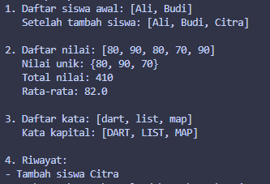
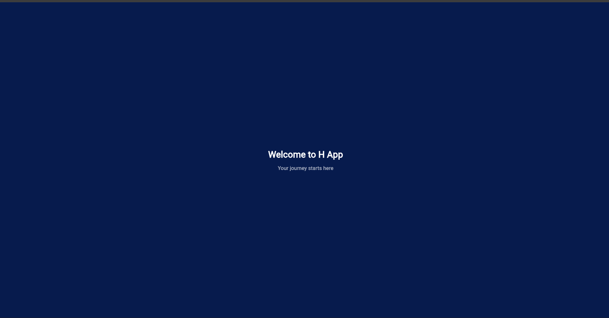

# Project Flutter & Dart

Kumpulan tugas pemrograman Dart dan Flutter.

## Aritmatika

Program Dart berbasis terminal untuk operasi hitung, luas dan keliling lingkaran, rata-rata nilai, membandingkan angka, dan menghitung akar.

Source code: [`Dart/apk 1/lib/latihan.dart`](Dart/apk%201/lib/latihan.dart)

## Data Collection

Latihan pengelolaan data memakai `List`, `Set`, dan `Map`, termasuk menambah dan menghapus elemen, menyaring angka unik, serta mengolah data siswa.

Source code: [`Dart/apk 1/lib/DataCol.dart`](Dart/apk%201/lib/DataCol.dart)

## Hasil UTS

Program UTS mengolah data siswa, nilai, kata, dan riwayat aktivitas.

Source code fungsi: [`Dart/apk 1/lib/uts_1.dart`](Dart/apk%201/lib/uts_1.dart#L5-L47)

Fungsi dipanggil dari `main()` di [`Dart/apk 1/bin/apk.dart`](Dart/apk%201/bin/apk.dart#L3-L23): `tambahSiswa` (baris 9), `simpanHistory` (baris 10), `nilaiUnik` (baris 14), `hitungTotal` (baris 15), `hitungRataRata` (baris 16), `ubahKapital` (baris 19), dan `tampilkanHistory` (baris 22). Fungsi `buatDataSiswa` dan `cekKunci` sudah tersedia di file fungsi, tetapi belum dipanggil dari `main()`.

## Splash Screen

Tampilan splash screen dengan logo aplikasi.

## Onboarding

Layar sambutan yang tersedia saat ini. Implementasinya berupa satu halaman `SplashScreen`, belum berupa rangkaian beberapa halaman onboarding.

Source code: [`Flutter/flutter_bu-Rosy/fluter_proj/lib/onboarding_screen.dart`](Flutter/flutter_bu-Rosy/fluter_proj/lib/onboarding_screen.dart)

